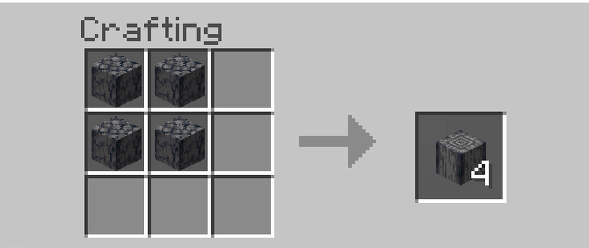

# Polished Basalt

> In Minecraft you craft four Basalt into four Polished Basalt. Same block, smoother surface.
> 

Polished Basalt is a personal fork of [Basalt](https://github.com/jesdga95/basalt) (the Qwen3.8-Flash-Next engine, itself descended
from [Strata](https://github.com/Niko1221/Strata)), tuned for one machine:

| | |
|---|---|
| GPU | RTX 5080 16 GB (sm_120, 84 SMs, PCIe 5.0 x16) |
| CPU | Ryzen 7 9800X3D (8 cores, AVX-512) |
| RAM | 128 GB DDR5 |
| OS | Windows 11, native (WSL measured slower, see `docs/polished-basalt/WSL_VS_WINDOWS.md`) |
| Model | Qwen3.8-Flash-Next GSQ-RCO IQ3_S, 256K context, full routing, high reasoning |

## What it is

Upstream `main` plus a curated set of fixes that are still open upstream, a few new ones, and the tooling to run them safely:

- **Engine:** PCIe staging for single requests and mixed packs (basalt #82), AVX-512 sign masks (#86), Windows power-throttling
  opt-out (#93), two-heads-per-block GDN (#85, opt-in), pinned-memory headroom, draft-threshold knob.
- **Server:** retry-aware checkpoint routing (#89), conversation-cache minimum (#67), answer room so thinking cannot eat the answer (#95).
- **Local additions from the Codex build:** external PLE table (no second 87 GB pack), `/chat` page.
- **Around the engine:** a request scheduler proxy (`fork/scheduler/`), Windows build/start/stop scripts (`fork/windows/`),
  four A/B profile arms (`fork/profiles/`).

Every change is its own commit with provenance, a kill switch where it can drift numerics, and an entry in
[`docs/polished-basalt/PATCHES.md`](docs/polished-basalt/PATCHES.md).

## Honest status

- **Nothing has run on the 5080 PC.** Code was assembled, rebased, unit-tested where possible on a Mac (serve tests, scheduler tests,
  the pdep bit-identity proof) and read-checked. CUDA and Windows-specific code has not been compiled here.
- **No combined speedup is measured.** The old 115 tok/s reference used thinking off and cannot support a high-reasoning
  forecast. See [`EXPECTED_GAINS.md`](docs/polished-basalt/EXPECTED_GAINS.md) for separate workloads, evidence and limits.
- Anything unproven is either opt-in (`BASALT_FORK_GDN_REC2=1`) or has a kill switch.

## Map

| Path | What |
|---|---|
| `docs/polished-basalt/PATCHES.md` | every change, source, risk, kill switch |
| `docs/polished-basalt/EXPECTED_GAINS.md` | measured evidence, candidate benefits and limits |
| `docs/polished-basalt/TEST_PLAN.md` | the ordered checklist to run on the PC |
| `docs/polished-basalt/WSL_VS_WINDOWS.md` | why the Linux-in-Windows test was slower |
| `docs/polished-basalt/RESEARCH.md` | what upstream issues/PRs, Strata and the community say |
| `docs/polished-basalt/CODEX_INTEGRATION.md` | making Codex / Claude Code use the model efficiently |
| `fork/windows/` | `Build-Fork.cmd`, `Start-ForkBasalt.ps1`, `Stop-ForkBasalt.ps1` (own port 18892, never touches production) |
| `fork/profiles/` | `a0`–`a3` launch profiles for A/B |
| `fork/scheduler/` | priority and prefix-aware proxy for the single slot |

## Branches

- `polished-basalt`: the fork (default).
- `opt/pr28-windows-memory-seams`: optional, upstream PR #28 applied on top (large pages and DXGI-budget cache sizing).
- `main`: untouched upstream mirror. `rtx5080-win-b2fe`: the earlier base, kept for reference.

## Upstream relationship

`git remote add upstream https://github.com/jesdga95/basalt.git` and rebase `polished-basalt` onto `upstream/main` when you want
newer fixes. Open PRs that conflict are listed in `PATCHES.md` section D. Licences: MIT (Basalt, Strata); see `LICENSE` and
`THIRD_PARTY_LICENSES`.
