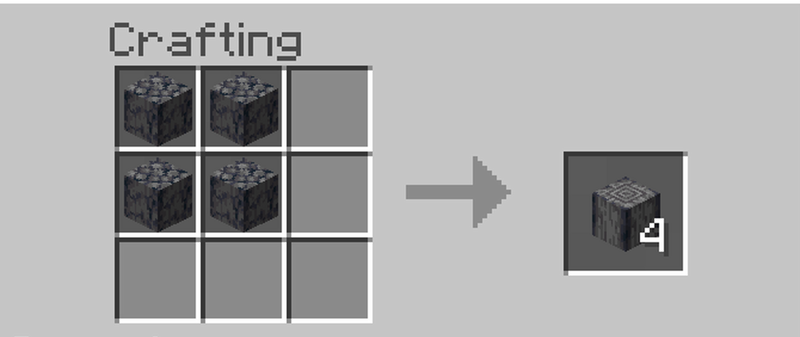

# Polished Basalt

<p align="center"></p>

A personal, experimental [Basalt](https://github.com/jesdga95/basalt) fork for an RTX 5080, Ryzen 7 9800X3D and 128 GB RAM.
Basalt descends from [Strata](https://github.com/Niko1221/Strata). Both upstream projects and their contributors retain their
credits and licences.

The target is full Qwen3.8-Flash-Next IQ3_S, high reasoning and a 262,144-token window on native Windows. The fork combines
selected engine experiments with tested improvements to request handling, cancellation, input boundaries and test integrity.

**Status:** local host tests do not establish a Windows/CUDA build, target model quality or a measured speedup. The complete
fork has not demonstrated 140 tokens/s under those conditions. Existing upstream benchmark numbers are not this fork's
results. Keep the accepted daily setup until the target validation passes.

## Start here

- [Build, test and adjust on the PC](docs/polished-basalt/QUICKSTART.md)
- [Ordered target validation](docs/polished-basalt/TEST_PLAN.md)
- [What changed, provenance and switches](docs/polished-basalt/PATCHES.md)
- [Evidence and limits](docs/polished-basalt/EXPECTED_GAINS.md)
- [Windows versus WSL](docs/polished-basalt/WSL_VS_WINDOWS.md)
- [Codex integration](docs/polished-basalt/CODEX_INTEGRATION.md)
- [Upstream documentation](UPSTREAM_README.md)

## Fast local checks

With the repository's test dependencies and pytest installed:

```sh
python fork/tools/checks.py quick
python fork/tools/checks.py full
```

These use local fake engines, fixtures and test servers. They do not contact the PC or load a model. The GPU and numerical
quality gates are separate. GitHub CI runs on pushes, pull requests and manual dispatch; it compiles Linux and Windows CUDA
code and runs host tests without a GPU. Do not interpret a green CI result as a model-speed benchmark.

## Experiment controls

The recovered launcher verifies source, binary, profile, model and process identity. Each profile has an isolated endpoint
and run directory. Per-arm switches live only in the child environment. Startup refuses an occupied production/candidate
port. Stop verifies the recorded process and reports failure rather than claiming an unsuccessful shutdown worked.

Candidate manifests and rollback archives remain local and ignored by Git. A promotion plan prints differences; it does not
replace the daily profile. Full model hashes can take time to verify. Build once per source change and reuse the frozen
workloads and receipts for matched profile comparisons.

## Models

<p align="center"></p>

Ready-to-run packs, with the quality of each measured against Q8_0, are on
[Hugging Face](https://huggingface.co/jesdga/Qwen3.8-Flash-Next-Basalt):
`Qwen3.8-FN-NVFP4-DQ6_K`, `-NVFP4-DQ8`, `-UD-Q4_K_XL`, `-UD-Q5_K_XL`, `-UD-Q6_K_XL`, `-Q8_0`, `-GSQ-RCO-IQ3_S`, `-GSQ-RCO-IQ3_XXS` and `-GSQ-RCO-Q2_0` (each `.basalt`).
The two NVFP4 packs share NVIDIA's NVFP4 experts; `D` names the dense projections' format: DQ6_K is the default and
faster, DQ8 is about 7% slower on prose with a lower KLD ([precision](docs/precision/isolated-costs.md)).
A model is one file: weights, tokenizer, MTP drafter, 8-bit hyper-connection copies and vision projector. The expert
profile ships with the engine ([data/profiles](data/profiles)).

## Docs

- [Configuration](docs/configuration/index.md): every setting.
- [Running](docs/running.md): parallel requests, prompt chunks, memory floors, image input.
- [basalt-probe](docs/probe.md): measures the machine, the cold decode speed, and suggests values.
- [The .basalt model file](docs/model-file.md): the layout, and building a pack yourself (including NVFP4).
- [Platforms](docs/platforms.md): Linux and Windows requirements, the build steps and the Windows limitations.
- [Changelog](docs/changelog/index.md): what each release changed.
- [Building and testing](docs/building.md), [Precision and quality](docs/precision/index.md), [Contributing](CONTRIBUTING.md).

## Credits

- [Strata](https://github.com/Niko1221/Strata): the project Basalt forks (MIT).
- [Qwen](https://huggingface.co/Qwen/Qwen3.8-Flash-Next): the model. The packs are under the [Qwen Community License 1.0](https://huggingface.co/Qwen/Qwen3.8-Flash-Next/blob/main/LICENSE), not Basalt's MIT license.
- [unsloth](https://huggingface.co/unsloth): the UD and Q8_0 GGUFs the packs are built from.
- IST Austria DAS Lab: the GSQ-RCO quants; please cite [GSQ](https://arxiv.org/abs/2604.18556) and [RCO](https://arxiv.org/abs/2605.00649).
- [NVIDIA](https://huggingface.co/nvidia/Qwen3.8-Flash-Next-NVFP4): the NVFP4 experts.
- [ggml and llama.cpp](https://github.com/ggml-org/llama.cpp): quantization formats and kernels extracted into `src/` (MIT, see [THIRD_PARTY_LICENSES](THIRD_PARTY_LICENSES)).

## License

MIT, see [LICENSE](LICENSE).
No weights, credentials, private transcripts or benchmark claims from an unrun experiment are distributed here. See
[CONTRIBUTING.md](CONTRIBUTING.md), [LICENSE](LICENSE) and [THIRD_PARTY_LICENSES](THIRD_PARTY_LICENSES).
